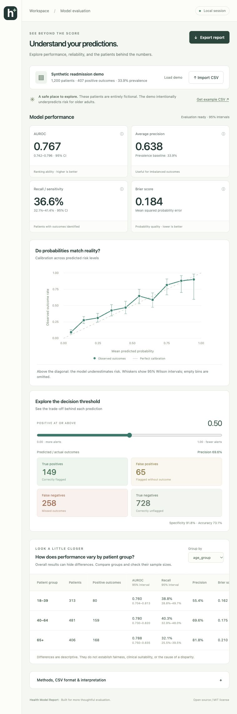

# Health Model Report

[](https://github.com/pemalama12/health-model-report/actions/workflows/tests.yml)

**Understand where your healthcare classifier works—and where it misses people.**

A local dashboard and Python CLI that turn binary model predictions into calibration plots, threshold trade-offs, subgroup comparisons, and a standalone HTML report. Bring a CSV; no model integration or cloud account required.



## Try it

Requires Python 3.11 or newer.

```bash
git clone https://github.com/pemalama12/health-model-report.git
cd health-model-report
python3 -m venv .venv
source .venv/bin/activate
python -m pip install -e .
health-model-report serve
```

On Windows, activate with `.venv\Scripts\activate`.

Open **http://127.0.0.1:8765**. The dashboard starts with 1,200 fictional patients in a reproducible readmission scenario. Older adults have intentionally underpredicted risk, demonstrating why aggregate metrics deserve a closer look. Click **Import CSV** to use your own predictions, change the threshold, select a patient group, and export an HTML snapshot.

This package is installed from source; it has not been published to PyPI. Stop the server with Ctrl+C. Use `health-model-report serve --port 8766` if the default port is busy.

## What you get

- AUROC with a deterministic bootstrap confidence interval.
- Average precision, prevalence, Brier score, precision, recall, specificity, and accuracy.
- Calibration plot with bin sizes and Wilson confidence intervals.
- Interactive decision threshold and confusion matrix.
- Subgroup tables with sample sizes, outcome counts, AUROC and recall intervals, and small-sample notices.
- A self-contained HTML export with inline charts and aggregate results. Works offline and prints from your browser.
- CLI and importable Python functions for reproducible workflows.

## CSV format

```csv
patient_id,y_true,y_score,age_group,care_site
P001,1,0.82,65+,North
P002,0,0.14,18–39,South
P003,1,0.43,40–64,North
```

| Column | Meaning |
| --- | --- |
| `y_true` | Required binary outcome, 0 or 1. |
| `y_score` | Required positive-class probability, from 0 to 1. Do not supply logits. |
| `patient_id` | Optional. If supplied, values must be nonempty and unique. Excluded from reports. |
| Other columns | Optional categorical subgroup attributes. Missing labels appear as `(missing)`. |

Use one independent, held-out observation per patient. Bin continuous attributes such as age before import. Limits: UTF-8 CSV, 8 MB, 50,000 rows, 12 subgroup columns, 30 categories per column. Single-class datasets are accepted; undefined metrics are shown as N/A. Invalid probabilities, duplicate IDs, and malformed rows produce actionable errors.

## Command line

```bash
health-model-report demo --output demo.csv
health-model-report evaluate demo.csv --group age_group --threshold 0.35 --output report.html --json metrics.json
```

`examples/synthetic-readmission.csv` and `examples/sample-report.html` are included for immediate exploration.

## Python

```python
from pathlib import Path
from health_model_report.data import parse_csv
from health_model_report.metrics import evaluate
from health_model_report.report import render_report

dataset = parse_csv(Path("predictions.csv").read_text(encoding="utf-8-sig"))
result = evaluate(dataset, threshold=0.35, group="age_group")
Path("report.html").write_text(render_report(result), encoding="utf-8")
```

## Methods and limits

Predicted positive means `y_score >= threshold`. AUROC, average precision, Brier score, and ROC coordinates use scikit-learn. Average precision is its non-interpolated definition, not trapezoidal PR AUC.

AUROC intervals use 200 patient-level bootstrap resamples, a fixed seed of 42, and percentile 95% intervals. Resamples missing an outcome class are skipped; intervals require at least 100 valid resamples. This quick exploratory estimate can be unreliable for rare outcomes. Recall, precision, and calibration proportions use 95% Wilson intervals. Calibration uses ten equal-width probability bins, omitting empty bins. Brier score measures overall probability error and is not a pure measure of calibration.

The dashboard flags groups with fewer than 30 observations, 10 positive outcomes, or 10 negative outcomes; these are simple caution rules, not evidence that larger groups are sufficiently powered. Intervals are not adjusted for multiple comparisons. Subgroups are compared one attribute at a time; overlapping/intersectional analysis is a future extension.

The tool cannot verify label quality, train/test leakage, independence, or whether the data represents a deployment population. Repeated encounters require a different resampling method. Select operating thresholds on validation data before assessing final held-out test performance. Performance differences do not establish causal bias, fairness, or clinical suitability. This is a research and educational tool; it does not provide clinical advice or certify models for patient care.

## Data handling

The dashboard connects only to a Python server bound to `127.0.0.1`. The app makes no external requests and uses no telemetry, CDNs, or external fonts. Imported data is processed in memory. Up to 64 recent AUROC bootstrap results are cached in process memory, including outcome and score tuples, until eviction or server exit. Uploaded CSVs are not written to disk by the server.

HTML and JSON exports contain aggregate results, including subgroup labels; raw patient records and identifiers are omitted. The local server retains the eight most recent HTML snapshots in memory to support direct downloads and preview links; these disappear on server exit or eviction. Review aggregate labels and small groups before sharing. This is a local development server, not a hosted multi-user service; do not expose it through a public tunnel.

## Contribute

Start with [CONTRIBUTING.md](CONTRIBUTING.md) and the scoped tasks in [ROADMAP.md](ROADMAP.md). Good contributions include accessible chart improvements, new synthetic examples, tests for edge cases, and clearer explanations.

```bash
python -m pip install -e '.[dev]'
python -m pytest
python -m build
```

GitHub Actions runs tests and package builds on Python 3.11, 3.12, and 3.13. See the [latest CI results](https://github.com/pemalama12/health-model-report/actions/workflows/tests.yml).

## Related work

[CyclOps](https://github.com/VectorInstitute/cyclops) provides a broader framework for clinical model evaluation and monitoring. [Fairlearn](https://github.com/fairlearn/fairlearn) provides fairness assessment and mitigation tools. Health Model Report focuses on a small, approachable CSV-to-report workflow and does not replace those projects. Metric calculations build on [scikit-learn](https://scikit-learn.org/).

MIT licensed. Contributions welcome.
